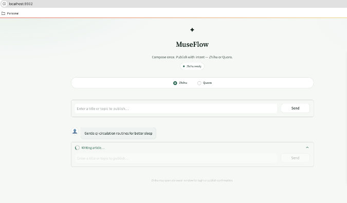
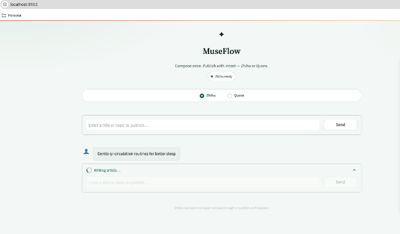
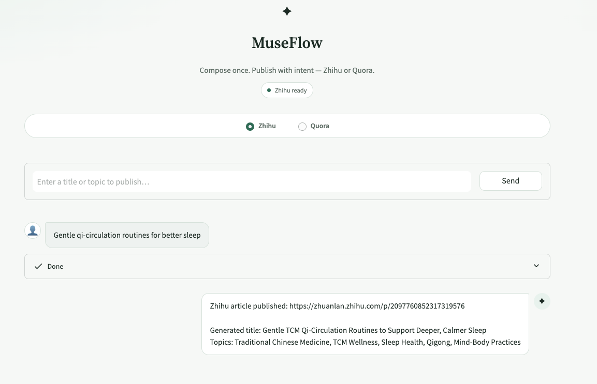
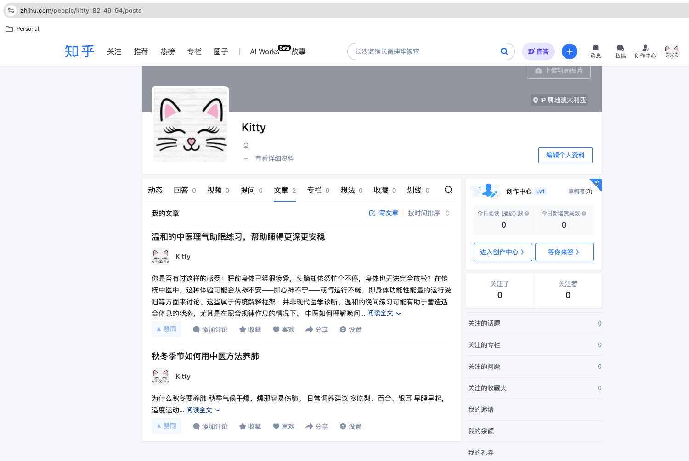

# MuseFlow

**AI content creation and multi-platform publishing for Zhihu (Chinese) and Quora (English)**

## Tech Stack

- **Language:** Python
- **Frontend:** Streamlit
- **Workflow:** LangChain node pipeline (content → images → check → publish)
- **LLM:** OpenAI-compatible chat API (`langchain-openai`)
- **Images:** OpenAI image generation API
- **Browser automation:** Playwright
- **Content:** Markdown → HTML paste into rich-text editors
- **Runtime:** python-dotenv, local browser session cookies

## What It Does

MuseFlow turns a short topic into a full article workflow: write the post, generate cover-style images, run a content safety check, then publish through a real browser session.

| Channel | Language | Write article | Generate images | Publish |
| --- | --- | --- | --- | --- |
| **Zhihu** (知乎专栏) | Chinese | Yes | Yes | Yes (live) |
| **Quora** | English | Yes (planned node) | Yes (planned node) | Yes (planned node) |

**Zhihu (Chinese)** is the primary live path today:

1. Enter a topic in the Streamlit chat UI (Zhihu selected).
2. The LLM writes a TCM / wellness-style article (English draft first in the node, then Chinese for the column).
3. An image model generates illustration assets under `pictures/`.
4. A check node rejects empty fields and banned phrases.
5. Playwright opens [知乎写文章](https://zhuanlan.zhihu.com/write), fills title/body, uploads images, adds topics, and publishes.
6. Login is interactive the first time; the session is saved under `cookie/` for reuse.

**Quora (English)** is supported in the product UI as a first-class channel: English article writing, image generation, and publish are part of the MuseFlow design. Quora screenshots and the full Playwright publisher will be added next; the Streamlit switch already exposes **Quora** beside **Zhihu**.

Private prompts, selectors, banned-word lists, timeouts, and other publish mechanics live in `.env` (see `.env.example`). Do not commit that file.

---

## Setup

All commands below assume you start from the `MuseFlow/` directory.

### Install Dependencies

```bash
python -m venv .venv
source .venv/bin/activate   # Windows: .venv\Scripts\activate
pip install -r requirements.txt
playwright install chromium
```

### Configure Environment

```bash
cp .env.example .env
```

Fill in at least:

| Key | Purpose |
| --- | --- |
| `MODEL_API_KEY` / `MODEL_BASE_URL` / `MODEL_NAME` | Chat LLM for writing, translation, and image prompts |
| `IMAGE_MODEL_NAME` | Image generation model |
| `ZHIHU_*` private keys | Prompts, selectors, timeouts, dry-run samples (required for Zhihu) |

### Run MuseFlow

```bash
streamlit run app.py
```

| Service | URL |
| --- | --- |
| MuseFlow UI | `http://localhost:8501` (or the port Streamlit prints) |

In the UI, choose **Zhihu** or **Quora**, enter a topic, then press **Send**.

For Zhihu, a browser window may open on first run for login or phone binding. The session is saved under `cookie/` and reused next time.

---

## Product Walkthrough

### Landing / chat console

Streamlit home: brand, Zhihu / Quora switch, topic field, and Send.

<p></p>

### Writing in progress

After Send, the pipeline reports live status (writing, images, check, publish).

<p></p>

### Publish result in the UI

When Zhihu publish succeeds, the chat returns the article URL, generated title, and topics.

<p></p>

### Published Chinese article on Zhihu
#### Zhihu profile — published posts

Creator **文章** list showing multiple MuseFlow-published Chinese posts.

<p></p>

> Screenshots above are from the **Chinese Zhihu** path. **English Quora** UI and publish screenshots will be added when that channel ships.


## Notes

- Prefer the project `.venv` when running Streamlit so Playwright and LangChain match `requirements.txt`.
- Zhihu may require phone binding before publish; complete that in a normal browser if SMS fails inside automation.
- Success is a public article URL (`/p/<id>`), not a draft `/edit` page.
- Quora English write → image → publish will mirror the Zhihu node layout once wired; keep using the Quora toggle in the UI to select that channel.
